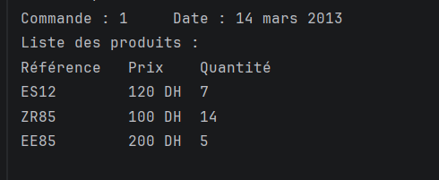

# Exercice 1 – Gestion de stock

## Objectif
Développer une application Java avec **Hibernate** et **MySQL** pour gérer le stock d'un magasin de produits informatiques : catégories, produits, commandes et lignes de commande.

## Résultat

Cette capture affiche les produits de la **commande n°1** du **14 mars 2013**, avec la référence, le prix et la quantité de chaque produit.