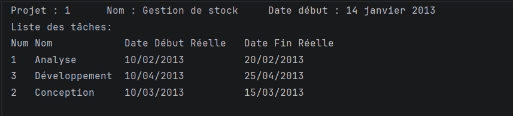

# Exercice 2 – Gestion de projets

## Objectif
Développer une application Java avec **Hibernate** et **MySQL** pour suivre le temps passé par les employés sur les tâches des projets d'un bureau d'études.

## Résultat

Cette capture affiche les tâches réalisées du **projet n°1 « Gestion de stock »**, commencé le **14 janvier 2013**, avec le numéro, le nom et les dates réelles de début et de fin de chaque tâche.