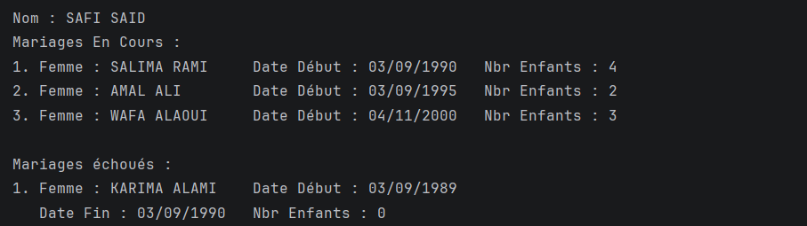

# Exercice 3 – Gestion de l'état civil

## Objectif
Développer une application Java avec **Hibernate** et **MySQL** pour gérer les citoyens d'une province (hommes et femmes) et leurs mariages.

## Résultat

Cette capture affiche les mariages de **SAFI SAID** :
- **3 mariages en cours**, avec la femme, la date de début et le nombre d'enfants ;
- **1 mariage échoué**, avec en plus la date de fin.